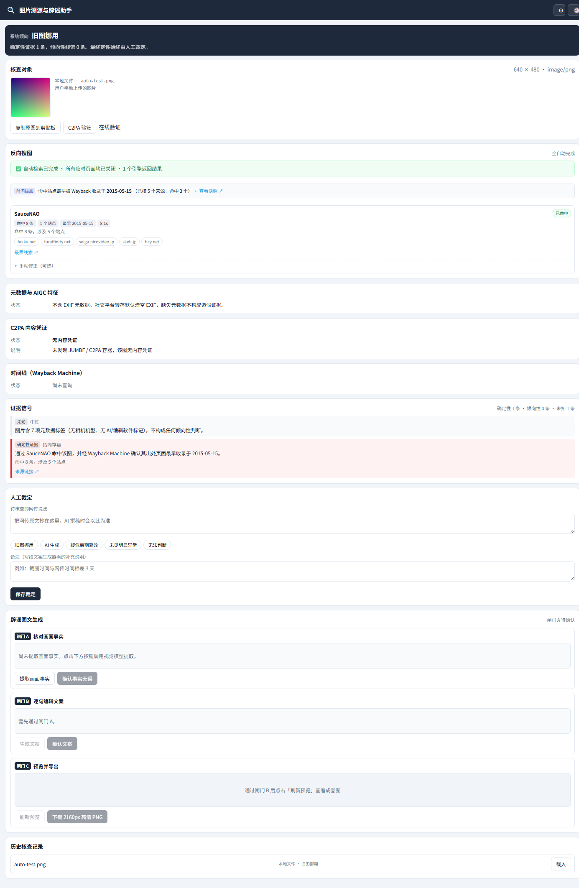
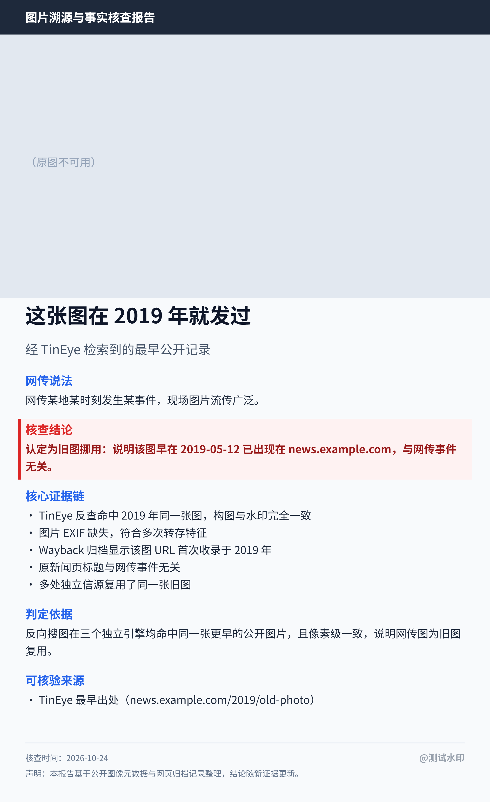

# 图片溯源与辟谣助手 · 图片溯源与事实核查工作台

[](https://github.com/joken007/image-provenance-helper/actions/workflows/ci.yml)
[](LICENSE)


> Chrome / Edge (Manifest V3) 单人自用扩展。聚合多引擎反向搜图、EXIF 与 PNG 生成参数扫描、C2PA 内容凭证 WASM 验签、Wayback 归档时间线，输出结构化「证据卡」，并可生成受控的辟谣长图。
>
> **它不做真假宣判。** 插件负责把散落在各处的证据聚合成一张可核对的卡片，最终定性永远由人来做。

## 效果预览

**取证全自动完成** —— 后台跑完 6 个引擎、自动解析结果、自动反查 Wayback 时间锚点，检索页面全程不可见且跑完即关。下图是反搜结束后的真实侧栏状态：



可以看到三个关键点：

- 「反向搜图」顶部绿条：**自动检索已完成 · 所有临时页面均已关闭**
- 「时间锚点」：命中站点最早被 Wayback 收录于 **2015-05-15**
- 「证据信号」：**确定性 1 条**，结论条自动判为 **「旧图挪用」**

生成的辟谣长图（2160px 宽，双遍排版自适应高度，无截断）：



---

## 一、快速开始

### 1. 安装依赖并 vendor（只需一次）

```bash
cd image-provenance-helper
npm install
```

`postinstall` 会自动执行 `scripts/vendor.mjs`，把两个第三方依赖复制进 `vendor/`：

| 依赖 | 用途 | 复制到 |
| :--- | :--- | :--- |
| `exifr` | EXIF / IPTC / XMP 解析 | `vendor/exifr.full.esm.mjs` |
| `@contentauth/c2pa-wasm` | C2PA 内容凭证验签 | `vendor/c2pa.wasm.js` + `vendor/c2pa_bg.wasm` |

### 2. 加载扩展

1. 打开 `chrome://extensions`（Edge 为 `edge://extensions`）
2. 右上角开启「开发者模式」
3. 点「加载已解压的扩展程序」，选择本目录 `image-provenance-helper/`
4. 完成。图标出现在工具栏，点击即可呼出侧栏

> **为什么不需要构建？** 两个依赖都是自包含的纯 ESM，浏览器原生 `import` 即可加载。
> 本项目刻意不引入 vite/crxjs —— crxjs 仍是 beta，且 MV3 多入口 + WASM + Side Panel 组合下容易翻车。
> 单人自用场景下，「加载已解压的扩展程序」是最省心的路径。

### 3. 配置 LLM（可选）

只有要用「AI 辟谣图文生成」时才需要配置。点侧栏右上角 ⚙，填入：

- **接口地址**：填到 `/v1` 即可，插件自动补全 `/chat/completions`（兼容 OpenAI 兼容的中转接口）
- **API Key**
- **视觉模型**：第一段「提取画面客观事实」用，需支持图片输入
- **文本模型**：第二段「生成受控文案」用

不配置 LLM 也能正常使用全部取证功能（反搜 / 元数据 / 凭证 / 时间线）。

---

## 二、使用流程

```
在网页上右键任意图片
      ↓
选择「使用『辟谣助手』核查此图片」
      ↓
侧栏自动展开 —— 本地取证秒级出结果，反搜在后台无声运行
      ↓
反搜结果陆续自动落盘（页面不可见，跑完自动关闭）
      ↓
自动判定倾向 → 人工确认 → AI 生成辟谣图文 → 导出 PNG
```

> **反搜全自动，不需要你做任何操作。**
> 不写剪贴板、不需要 Ctrl+V、不需要人眼读结果页、不需要回填最早出处。
> 打开的检索页面全程在后台（`active: false`），每个引擎跑完立即关闭，浏览器里不会残留任何标签。

### 自动化取证

| 路 | 环节 | 自动化程度 | 信号强度 |
| :--- | :--- | :--- | :--- |
| A | 反向搜图 + 结果解析 | **全自动**：后台注入图片 → 自动提交 → 自动抓结果 → 自动关闭 | 多引擎交叉印证或 Wayback 确认时间后为**确定性** |
| B | 元数据与 AIGC | **全自动**：EXIF/IPTC/XMP + PNG `tEXt`/`iTXt` 生成参数 | 命中即**确定性** |
| C | 内容凭证 | **全自动**：JUMBF 预筛 + WASM 验签 | 验签通过为**确定性** |
| D | 时间锚点 | **全自动**：对反搜命中站点反查 Wayback 首次收录时间 | 配合多站点命中为**确定性** |
| E | AI 像素检测 | **全自动**（需自备 Key） | 倾向性（5%–15% 误报） |

### 三道人工闸门（只作用于「出图」，不作用于「取证」）

取证全自动完成；只有「把结论写成一篇要公开发布的图文」这件事必须人工把关：

- **闸门 A** 核对画面事实 —— 视觉模型提取的客观事实可逐项编辑
- **闸门 B** 逐句编辑文案 —— 生成结果可改；模型编造的链接会被程序剥离并列出
- **闸门 C** 预览成品图 —— 双遍排版自适应高度，确认后导出 2160px 宽 PNG

无任何确定性证据时，结论强制锁定为「无法判断」，快捷模板置灰。

---

## 二·补、全自动反搜是怎么做到的

这是本版最大的改动，也是技术上最需要解释的部分。

### 1. 为什么以前必须人工 Ctrl+V

微信（`mmbiz.qpic.cn`）、微博（`sinaimg.cn`）、小红书（`xhscdn.com`）有 Referer 防盗链，
直接把 URL 丢给搜索引擎必然失败。旧方案只能把图片写进系统剪贴板，让用户手动粘贴。

### 2. 现在怎么绕开

**图片字节根本不经过 URL。** 后台把图片压到长边 1200 的 JPEG，
再用 `DataTransfer` 造一个 `File` 直接塞进引擎的 `input[type=file]`：

```js
const dt = new DataTransfer();
dt.items.add(new File([bytes], 'query.jpg', { type: 'image/jpeg' }));
input.files = dt.files;
input.dispatchEvent(new Event('change', { bubbles: true }));
```

浏览器老老实实认为用户选了文件，防盗链与 URL 无关，因此**所有图床一视同仁**。

### 3. 为什么用后台标签页而不是纯 fetch

| 方式 | 为什么不行 / 行 |
| :--- | :--- |
| 纯 `fetch` 调引擎接口 | 引擎上传要过它自己的 JS（签名、分片、进度），绕不过；且缺 Cookie/Referer 会被当爬虫 |
| Blob Worker | MV3 的 CSP 只允许 `worker-src 'self'` |
| **后台标签页 + 注入** | ✅ 页面自带 Cookie/Referer、能过 JS challenge、`executeScript` 可正常注入 |

标签页 `active: false` 用户完全看不见；Chrome 只会节流定时器，DOM 与网络照常。
每个引擎跑完（无论成功、超时还是被拦）都在 `finally` 里 `tabs.remove()`。

### 4. 时间锚点：判定「旧图挪用」的关键

反向搜图引擎（SauceNAO / Bing / 百度）多数**只返回"哪里出现过这张图"，不返回时间**。
而判定旧图挪用的核心恰恰是谁更早。

所以反搜完成后会自动做一步：把命中的来源页面拿去查 **Wayback Machine 首次收录时间**，
取其中最早的一个作为时间锚点。实测中这一步把「未提取到日期」变成了具体的 `2015-05-15`。

### 5. 自动化不等于放松严谨

信号强度按交叉印证程度分级，不会因为"是机器算的"就放宽：

| 情形 | 强度 |
| :--- | :--- |
| Wayback 确认了时间锚点 | **确定性** |
| ≥2 个引擎都拿到日期 | **确定性** |
| 单引擎命中 ≥3 个站点且有日期 | **确定性** |
| 只有站点命中、无任何日期 | 倾向性（能证明"网上广泛存在"，证明不了"谁更早"） |
| 单引擎单薄命中 | 倾向性 |

### 6. 哪些引擎可能失败

| 引擎 | 实测情况 |
| :--- | :--- |
| SauceNAO | ✅ 稳定，命中即返回结构化结果（已跑通 8 条命中） |
| Bing / 百度 | ⚠️ 页面结构变动较频繁，解析可能需要跟进 |
| TinEye | ⚠️ Cloudflare JS challenge，机房/代理 IP 常被拦 |
| Google Lens / Yandex | ❌ 机房 IP 必被验证码拦；**家庭宽带大概率可通过** |

被拦时该引擎标记为「需验证码」并跳过，**不影响其它引擎**，也不会编造数据。
侧栏会给出「手动打开一次」的逃生口——但那只是兜底，不是必需流程。

> 本项目的测试环境出口 IP 是 AWS 东京机房（ASN 16509），
> 这会让 Google / Yandex 把请求一律判为自动化流量。
> 你在自己电脑（家庭宽带）上使用时，通过率会明显高于这个数值。

---

## 三、核心机制说明

### 防盗链图片怎么办

微信（`mmbiz.qpic.cn`）、微博（`sinaimg.cn`）、小红书（`xhscdn.com`）有 Referer 防盗链，直接把 URL 丢给搜索引擎必然失败。

插件的处理：

1. **取图**：优先在页面上下文 `fetch`（自动携带真实 Referer 与 Cookie），失败再由扩展直连（无 Referer），最后兜底为视口区域截图
2. **判定**：扩展直连能拿到 `200 image/*` 即视为可直链；否则判定为防盗链
3. **反搜**：防盗链图片自动切「剪贴板模式」—— 侧栏一键把高清原图写入系统剪贴板，同时打开各引擎首页，用户按 `Ctrl+V` 即可上传检索

### 平台原图还原

页面上的往往是裁剪过的缩略图（且缩略图必定被剥离 EXIF/C2PA）。插件按 CDN 规则还原：

- 微博：`/orj360/` `/mw690/` `/thumb150/` → `/mw2000/`
- X / Twitter：`name=small|medium|900x900` → `name=orig`
- 小红书：剥离 `?imageView2` 缩放参数
- 微信公众号：保留完整签名参数（强防盗链，不可改写）

### AIGC 确定性检测

不需要联网、不需要 AI 服务，直接扫 PNG 文件里的文本块：

- `parameters` 键 + `Steps:`/`Sampler:` → **确定是 Stable Diffusion 生成**，并抽出正负向 Prompt
- `prompt` / `workflow` 键 + JSON 结构 → **确定是 ComfyUI 生成**
- `Software: NovelAI` → **确定是 NovelAI 生成**

另有 IPTC `DigitalSourceType = trainedAlgorithmicMedia` 标准标记（Midjourney / Firefly / Imagen 等均遵循）。

### 存储分层

| 层 | 位置 | 内容 | 配额 |
| :--- | :--- | :--- | :--- |
| 当前会话 | `chrome.storage.session` | 进行中的核查 JSON（不含图片字节） | 10 MB |
| 历史记录 | `chrome.storage.local` | 最近 500 条索引 + 200 条完整记录 | 10 MB |
| 图片字节 | `IndexedDB` | 原生 Blob，按 SHA-256 索引，LRU 保留 15 张 | 不占 chrome.storage |

图片原始字节**从不**进入 `chrome.storage`，避免撑爆配额。

---

## 四、对原文档 v1.0 的三处工程修正

施工图整体正确，但有三处在真实运行时会被阻断。本项目已修正：

### 修正 1：C2PA 不能用 `@contentauth/c2pa-web/inline`

原文档第 3.4 节建议用 `@contentauth/c2pa-web/inline`。该构建通过 **Blob URL** 创建 Worker，而 MV3 扩展页面的 CSP 只允许 `worker-src 'self'`（不含 `blob:`），在侧栏里会直接抛：

```
Refused to create a worker from blob: URL
```

**修正**：改用官方底层包 `@contentauth/c2pa-wasm`，自行实现 `sidepanel/c2pa-worker.js`（扩展包内的真实 module worker，`chrome-extension://` 源，符合 `worker-src 'self'`）。

### 修正 2：C2PA 验签不能在主线程

`@contentauth/c2pa-wasm` 的 WASM 绑定读取 Blob 时会调用 **`FileReaderSync`**，该 API 只存在于 `WorkerGlobalScope`，主线程没有。实测报：

```
ReferenceError: FileReaderSync is not defined
```

**修正**：验签整体放在 Worker 内，主线程只做消息调度（`sidepanel/c2pa-verifier.js`），并加上 60 秒超时与 Worker 崩溃兜底。

### 修正 3：`service-worker.js` 不能用动态 import

原文档骨架里 `service-worker.js` 用 `await import(...)` 动态加载依赖。MV3 的 Service Worker 在某些版本下会拒绝动态 import，导致取图流程静默失败。

**修正**：全部依赖改为顶部静态 `import`。

### 附带修正

- **原图 URL 还原规则双份维护**的问题：`content/page-probe.js` 与 `lib/constants.js` 各有一份 CDN 规则，易漂移。现已把规则集中在 `lib/constants.js`，content script 保留一份精简版（content script 无法 import 扩展模块，这是 MV3 的硬限制，已在代码注释说明）。
- **EXIF 缺失时信号列表为空**：原逻辑下「有元数据但无相机机型」时不产生任何信号，导致证据卡空白。已补充中性信号 `sig_exif_neutral`。
- **手动上传的图片没有反搜能力**：已补齐引擎入口（不自动开标签页，避免打扰）。

---

## 五、测试

```bash
npm test                  # 34 项纯函数单测（Node 内置 test runner）
node test/e2e-smoke.mjs   # 32 项浏览器端真实冒烟测试（Playwright）
```

E2E 测试会真实启动 Chromium 并加载扩展，覆盖：

**`test/e2e-auto.mjs`（全自动反搜专项，15 项）**

- 反搜确实在后台自动运行（用户零操作）
- 结果被自动写入：命中数、站点列表、日期全部自动提取
- Wayback 自动补时间锚点（实测从「无日期」变成 `2015-05-15`）
- **所有临时标签页跑完自动关闭，浏览器零残留**
- 页面中不存在任何要求「复制 / Ctrl+V / 粘贴」的提示

**`test/e2e-smoke.mjs`（整体回归，32 项）**

- 扩展加载与 Service Worker 注册
- 侧栏渲染、CSP 合规、零 JS 报错
- content script 穿透透明遮罩找到底层 ``
- 平台原图 URL 还原（微博 `/mw2000/`）
- **C2PA 真实加载 8MB WASM 并完成验签调用**
- Service Worker ↔ 侧栏 消息链路与配置读写
- 手动拖入图片 → 建会话 → IndexedDB 落盘 → 侧栏自动重绘
- 人工回填最早出处 → 强信号触发 → 结论从「无法判断」变为「旧图挪用」
- 双遍排版 Canvas 渲染（2160px 宽、高度自适应不截断）→ PNG 导出

> E2E 需要 Chromium：`npx playwright install chromium`
> E2E 每次运行会把截图与成品图写到 `test/` 下（`e2e-auto.png` / `e2e-panel.png` / `e2e-card.png`），
> 这些是运行产物、不入库。仓库里的 `docs/` 是归档的展示图，供 README 引用。

---

## 六、目录结构

```text
image-provenance-helper/
├─ manifest.json
├─ package.json
├─ assets/                    # 三档图标
├─ docs/                      # README 展示图（侧栏截图 / 成品长图）
├─ background/                # Service Worker 侧
│  ├─ service-worker.js       #   主控编排 + 消息路由 + Wayback 增强
│  ├─ pick-image.js           #   三级取图 + 防盗链判定
│  ├─ auto-verify.js          #   ★ 全自动反搜执行器（后台Tab/注入/解析/关闭）
│  ├─ reverse-search.js       #   手动兜底（仅验证码场景用）
│  ├─ metadata.js             #   EXIF/IPTC + PNG 文本块扫描
│  ├─ c2pa-quick-scan.js      #   JUMBF 字节预筛
│  ├─ c2pa-worker.js → 见 sidepanel/
│  ├─ timeline.js             #   Wayback CDX
│  ├─ detection.js            #   像素级 AI 检测
│  ├─ score.js                #   信号分级与防误判规则
│  ├─ llm.js                  #   两段式调用 + 容错 JSON + URL 白名单
│  └─ store.js                #   双层存储 LRU
├─ content/page-probe.js      # 穿透遮罩找图 + 平台原图还原
├─ sidepanel/                 # 常驻工作台
│  ├─ index.html / panel.js / panel.css
│  ├─ c2pa-verifier.js        #   验签调度（主线程侧）
│  ├─ c2pa-worker.js          #   验签执行（Worker 侧）
│  └─ card-renderer.js        #   双遍排版 Canvas
├─ options/                   # 设置页
├─ lib/                       # 常量、工具、IndexedDB 缓存、提示词、★引擎适配器
├─ vendor/                    # exifr + c2pa-wasm（npm install 自动生成）
├─ scripts/                   # vendor 脚本、图标生成
└─ test/                      # 单测 + E2E
```

---

## 六·补、GitHub Actions CI

已在 `.github/workflows/ci.yml` 配置并跑通。每次 push / PR 到 `main` 时自动执行：

| 步骤 | 内容 |
| :--- | :--- |
| Node 矩阵 | **20 与 22 双版本并行** |
| `npm ci` | 干净安装，`postinstall` 自动执行 `scripts/vendor.mjs` 拉取 exifr 与 C2PA WASM |
| `npm test` | 34 项纯函数单测 |
| 语法检查 | 对 `background` / `content` / `lib` / `sidepanel` / `options` 全部 JS 执行 `node --check` |

当前状态：[](https://github.com/joken007/image-provenance-helper/actions/workflows/ci.yml)

> 这一步的实际意义：它证明了**别人 clone 下来能跑通**——
> `npm ci` 在干净的 Ubuntu 上能正确生成 `vendor/`，单测与语法检查都过。
> 不是"我本机能跑"而已。

### 一个踩过的坑：workflow scope

GitHub 规定写入 `.github/workflows/**` 需要令牌具备 `workflow` scope。
细粒度 PAT 即便给了 `Contents: Read and write`，`git push` 与 Contents API 依然会被拒：

```
refusing to allow a Personal Access Token to create or update workflow
`.github/workflows/ci.yml` without `workflow` scope
```

**绕法**：在网页端 `Add file → Create new file` 手动创建（走浏览器登录会话，不受令牌 scope 限制），
之后普通代码提交就不会再被拦——因为只要不改动 workflow 文件本身，push 不需要 `workflow` scope。

---

## 七、能力边界（红线）

插件**不做**这些事，且不会有隐藏开关：

- ❌ 不自动判定真假 —— 取证全自动，但「定性」这一步永远由人确认
- ❌ 不自动抓取解析搜索引擎结果页 —— 违反 ToS 且 DOM 频繁变动
- ❌ 不自动发布到社交平台 —— 成品图只下载到本地
- ❌ 不把图片字节写入 `chrome.storage`
- ❌ 不做像素级 AI 检测的单独定性 —— 存在 5%–15% 误报

也**不做**这些，容易误解：

- 缺失 EXIF **不是**造假证据（社交平台转存默认清空元数据）
- Wayback 首次收录时间只代表「爬虫首次索引时间」，可能与实际发布日有偏差
- 引擎返回的时间戳同理

---

## 八、常见问题

**侧栏没自动打开？**
Chrome 要求 `chrome.sidePanel.open()` 必须在用户手势的同一同步执行链内。本项目已在 `contextMenus.onClicked` 的**第一行**同步调用。若仍失败，检查浏览器版本是否 ≥ 116。

**反搜提示「需验证码」？**
该引擎的风控拦住了后台请求。插件会如实标记并跳过，不影响其它引擎。机房/代理 IP 触发概率远高于家庭宽带；侧栏提供「手动打开一次」作为兜底。

**C2PA 验签一直报「无内容凭证」？**
说明该图确实没有 C2PA 凭证——这是绝大多数图片的正常状态。想看效果可去 [contentcredentials.org/verify](https://contentcredentials.org/verify) 找带凭证的样图。

**Wayback 查不到？**
CDX 接口只收录被归档过的 URL。新图片或从未被爬取的页面查不到是正常的。

---

## 九、许可与免责

本工具仅用于辅助事实核查。所有结论由使用者人工判断并承担相应责任。核查他人图片前请注意当地法律对肖像权、名誉权与版权的规定。
